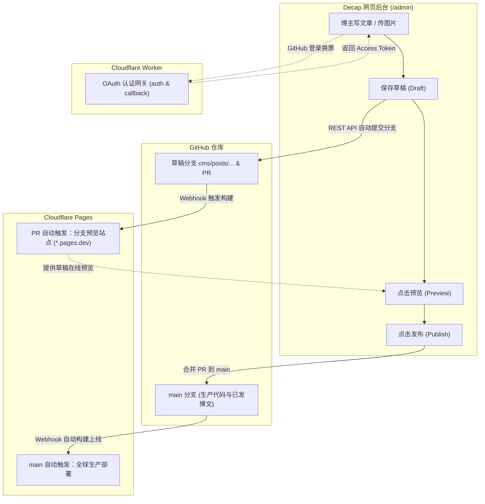

# 个人博客系统全栈工程化方案与生产级蓝图 (Production Blueprint)

> **项目名称**：Kael's Cyber Nexus（现代极客数字空间与知识花园）  
> **文档版本**：v3.0 (Cloudflare Pages 架构演进与写作发布链路深度修订版)  
> **文档状态**：设计修订稿，待发布链路验收 (Design Revision - Pending Live Pipeline Verification)  
> **核心定位**：以 **Decap CMS 网页后台**为首选写作入口，以 **Cloudflare Pages** 为全球静态托管与分支预览平台，以 **Cloudflare Worker** 为无服务器 OAuth 认证网关，Git/Obsidian 作为备用渠道。

---

## 目录 (Table of Contents)
1. [系统整体架构与四方职责分工 (Architecture & Division of Responsibilities)](#1-系统整体架构与四方职责分工)
2. [后台操作体验与“方便好操作”验收标准 (CMS Author Experience & Acceptance Criteria)](#2-后台操作体验与方便好操作验收标准)
3. [多维内容体系与 Schema 契约 (Content Architecture & Schema Contract)](#3-多维内容体系与-schema-契约)
   - 3.1 五大核心知识板块与单主分类原则
   - 3.2 Astro Content Collections 强类型校验规则
   - 3.3 示例文章真实性与数据规范 (消除虚构数据)
4. [发布链路与草稿工作流实施方案 (Publishing Pipeline & Editorial Workflow)](#4-发布链路与草稿工作流实施方案)
   - 4.1 Decap CMS 草稿发布工作流 (Editorial Workflow 状态机)
   - 4.2 Cloudflare Pages 分支预览与草稿预览联动 (Deploy Previews)
   - 4.3 时区与即时发布机制 (消除 UTC 与北京时间 8 小时时差)
   - 4.4 Cloudflare Worker GitHub OAuth 认证网关
   - 4.5 媒体资产管线与自动插入 (Public Image Pipeline)
   - 4.6 编辑器选型评估 (Markdown Widget vs Richtext Widget)
5. [全文检索引擎实施方案 (Full-Text Search Pipeline)](#5-全文检索引擎实施方案)
   - 5.1 Pagefind 自动化索引构建流程
   - 5.2 索引范围控制 (data-pagefind-body 与 data-pagefind-ignore)
   - 5.3 中文 CJK 分词与搜索降级机制
6. [UI/UX 视觉系统与阅读优先规范 (Visual Design & Reading First)](#6-uiux-视觉系统与阅读优先规范)
   - 6.1 色彩令牌与命名空间隔离 (避免 Tailwind 关键字冲突)
   - 6.2 移动端优先排版规范 (Mobile-First Layout Order)
   - 6.3 390px 视口导航无溢出设计
   - 6.4 正文实色底面与背景干扰抑制
   - 6.5 100% 杜绝 Emoji 与真实矢量图标系统
   - 6.6 侧边栏动态数据聚合 (杜绝硬编码静态数字)
7. [技术选型矩阵、性能预算与质量验收 (Technology Matrix & Verification)](#7-技术选型矩阵性能预算与质量验收)
   - 7.1 技术栈版本矩阵与兼容性
   - 7.2 可量化的包体预算 (Budget Targets)
   - 7.3 Three.js 动态按需加载与 prefers-reduced-motion 保护
   - 7.4 自动化持续集成质量门禁 (CI Quality Gate)
   - 7.5 已验证项与设计目标对照清单

---

## 1. 系统整体架构与四方职责分工

系统的核心设计准则是：**博主日常写作无需打开终端或执行 Git 指令，一切通过网页后台点选即可完成；同时享受 Git 版本控制与 Cloudflare 全球 CDN 的高可用红利。**



### 四方明确职责划分：

| 组成部分 | 核心职责 | 技术实现细节 |
| :--- | :--- | :--- |
| **Decap 网页后台**<br>(`/admin`) | **写作、传图、存草稿、预览、发布（首选第一入口）** | 静态单页应用，直连 GitHub REST API；作者所有操作抽象为友好按钮，隐藏底层复杂 Git 逻辑。 |
| **GitHub 仓库** | **永久保存文章、图片与历史修改** | 草稿阶段自动维护 `cms/posts/...` 分支与 Pull Request；发布阶段合并入 `main` 分支。 |
| **Cloudflare Pages** | **自动化构建、生产部署与分支预览** | 原生集成 GitHub：`main` 分支构建生产站；草稿 PR 分支自动生成独立预览站（Deploy Preview）。 |
| **Cloudflare Worker** | **轻量无服务器 OAuth 认证代理网关** | 运行于 Cloudflare Edge，安全保护 GitHub Client Secret，毫秒级为后台换取用户 GitHub Token。 |

> [!NOTE] 备用通道说明
> 博主在离线或使用 Obsidian / VS Code 时，仍可直接编辑 `src/content/posts/*.md` 并 `git push origin main`，与网页后台无缝共享相同的 Markdown 和图片资产目录。

---

## 2. 后台操作体验与“方便好操作”验收标准

为确保后台真正达到“方便好操作”的技术与体验要求，确立以下 6 大验收条件：

1. **入口直观明了**：
   - 访问 `/admin` 登录后，直接呈现文章列表界面与显眼的“新建文章（New 文章）”按钮，无多余层级。
2. **第一屏写作聚焦**：
   - 编辑表单置顶呈现核心三要素：**标题 (title)**、**所属分类 (category)** 与 **正文内容 (body)**；
   - 摘要 (description) 支持一句话概括；发布时间默认当前日期；
   - 系列 (series)、置顶 (featured)、难度等级 (difficulty) 等进阶属性默认折叠收进高级选项，不干扰普通写作心流。
3. **图片一键上传与正文直插**：
   - 工具栏提供直观的图片上传按钮，支持本地文件选取或直接拖拽图片到编辑器；
   - 图片上传后自动存入 `public/images/posts/` 并自动插入正文为标准 Markdown 引用（`/images/posts/{filename}`），作者无需关心路径。
4. **严格区分“保存草稿”、“预览”与“发布”**：
   - 采用 Decap 的 **Editorial Workflow（草稿发布工作流）**；
   - 点击“Save”仅存入草稿分支，绝对不会意外触发生产站上线；
   - 草稿看板清晰呈现三个阶段：`Drafts（草稿中）` -> `In Review（审核校对）` -> `Ready（准备上线）`；
   - 点击“Publish”才真正将内容合并入 `main` 分支上线。
5. **构建状态与预览联动直达**：
   - 保存草稿后，后台提供预览按钮，联动打开 Cloudflare Pages 的对应分支预览地址；
   - 构建失败时保留本地编辑器草稿内容，不丢稿，并给出可理解的错误提示。
6. **编辑器渲染一致性**：
   - 编辑器支持代码块（带语法高亮）、标准 Markdown 表格、数学公式与引用提示框，与前台正式渲染样式保持视觉一致。

---

## 3. 多维内容体系与 Schema 契约

### 3.1 五大核心知识板块与单主分类原则
为避免跨领域主题分类混乱，系统确立如下原则：
- **单主分类原则 (Single Primary Category)**：每篇文章必须且只能归属于五大板块之一；
- **交叉主题标签化 (Tags for Cross-Domain)**：跨领域主题（如“AI 辅助代码审计”、“eBPF 分布式追踪”）通过 `tags` 标签横向切分；
- **系列化聚合 (Series Aggregation)**：连续长文专栏通过 `series` 字段实现自动连载索引。

五大官方统一命名规范：
1. **软件工程与系统**：涵盖 Rust 高性能服务端、现代 Web 标准、微服务网关、分布式系统与并发工程。
2. **AI 与前沿科研**：涵盖多模态大语言模型、学术文献精读、自动化程序修复实验与算法验证。
3. **极客安全与攻防**：涵盖 CTF 赛事题解、Java/Web 白盒代码审计、内存马机制与红蓝对抗复盘。
4. **计算机体系沉淀**：涵盖 Linux 内核走读、eBPF 实时追踪、操作系统底层原理与网络协议栈剖析。
5. **生活随笔与杂项**：涵盖极客硬件折腾、个人知识管理系统（PKM）、工作流效率工具与心路随笔。

### 3.2 Astro Content Collections 强类型校验规则
在 `src/content/config.ts` 中定义的严格 Zod 契约：

```typescript
import { defineCollection, z } from 'astro:content';

const postsCollection = defineCollection({
  type: 'content',
  schema: z.object({
    // 基础必填字段
    title: z.string().min(1, '标题必填').max(100, '标题不可超过 100 字符'),
    description: z.string().min(1, '文章摘要必填').max(260, '摘要不可超过 260 字符'),
    
    // 日期容错校验：兼容 Date 对象以及 YYYY-MM-DD / ISO 字符串输入
    pubDate: z.coerce.date(),
    updatedDate: z.coerce.date().optional(),
    
    // 五大统一分类枚举
    category: z.enum([
      '软件工程与系统',
      'AI 与前沿科研',
      '极客安全与攻防',
      '计算机体系沉淀',
      '生活随笔与杂项'
    ]),
    
    // 标签、系列与状态
    tags: z.array(z.string()).default([]),
    series: z.string().optional(),          // 系列文章名称
    featured: z.boolean().default(false),    // 首页置顶推荐
    draft: z.boolean().default(false),       // 草稿状态 (正式生产构建自动过滤)
    views: z.string().optional(),            // 访问量 (可选，杜绝虚假硬编码)
    
    // 媒体图片支持：本地静态路径 (/images/posts/...) 或外部 CDN URL
    coverImage: z.string().optional(),
    
    // 专栏扩展字段 (选填)
    extraMeta: z.object({
      targetEvent: z.string().optional(),    // 赛事名称
      difficulty: z.enum(['入门', '进阶', '硬核']).optional(),
      paperDoi: z.string().optional(),       // 学术文献 DOI
      repoUrl: z.string().url().optional(),  // 关联代码仓库
    }).optional()
  }),
});

export const collections = {
  posts: postsCollection,
};
```

### 3.3 示例文章真实性与数据规范
1. **消除硬编码阅读量**：彻底移除 Schema 中默认 `1,000+` 的虚假数据设定。无访问分析插件回填时，前台优雅隐藏该字段。
2. **科研与工程演示声明**：示例文章中涉及的指标数据（如“准确率提升 31.4%”）与 DOI，均明确标注为 `[DEMO 示例数据]`。
3. **真实分类聚合**：全站侧边栏各分类文章计数改由 `getPublishedPosts()` 在构建期真实遍历统计，杜绝静态写死。

---

## 4. 发布链路与草稿工作流实施方案

### 4.1 Decap CMS 草稿发布工作流 (Editorial Workflow)
在 `public/admin/config.yml` 中配置 `publish_mode: editorial_workflow`：

```yaml
publish_mode: editorial_workflow

backend:
  name: github
  repo: your-username/blogWeb
  branch: main
  base_url: https://auth.kael-nexus.dev
  auth_endpoint: auth

media_folder: "public/images/posts"
public_folder: "/images/posts"
preview_path: "posts/{{slug}}"
```

#### 工作流状态机：
1. **新建与草稿 (Drafts)**：作者点击保存后，Decap 通过 GitHub API 自动创建分支 `cms/posts/YYYY-MM-DD-slug` 并发起对应的 Pull Request。`main` 分支不发生任何改动。
2. **评审校对 (In Review / Ready)**：作者可在后台看板中拖拽文章卡片调整状态，修改内容时自动追加 Commit 到该分支。
3. **正式发布 (Published)**：作者点击“Publish”按钮，Decap 自动通过 API 合并该 Pull Request 到 `main` 分支，并删除临时分支。合并动作触发 Cloudflare Pages 生产上线。

### 4.2 Cloudflare Pages 分支预览与草稿预览联动
Cloudflare Pages 原生支持 **Deploy Previews**：当检测到 GitHub 仓库新建 PR（即 Decap 创建草稿分支）时，会自动拉取该分支并构建出唯一的预览站点（形如 `https://<commit-hash>.<project>.pages.dev`）。

在 `src/utils/posts.ts` 中针对预览环境放行草稿：
```typescript
export function isPreviewEnvironment(): boolean {
  if (!import.meta.env.PROD) return true;
  if (process.env.SHOW_DRAFTS === 'true') return true;
  if (process.env.CF_PAGES_BRANCH && process.env.CF_PAGES_BRANCH !== 'main') return true;
  return false;
}

export async function getPublishedPosts(options?: { forceIncludeDrafts?: boolean }) {
  const posts = await getCollection('posts');
  const allowDrafts = options?.forceIncludeDrafts ?? isPreviewEnvironment();
  // ...
  return posts.filter(post => {
    if (!allowDrafts && post.data.draft) return false;
    // ...
    return true;
  });
}
```
结合后台配置的 `preview_path: "posts/{{slug}}"`, 作者在编辑草稿时点击预览，可直接精准跳转到预览站点中的对应文章页面。

### 4.3 时区与即时发布机制
#### 陷阱分析：
JavaScript `new Date("2026-10-12")` 按照 ECMAScript 标准解析为 UTC 时间 `2026-10-12T00:00:00.000Z`。在东八区（北京时间），这对应早上 08:00:00。如果博主在清晨 06:00 撰写并发布当天的文章，简单的 `pubDate > now` 会将 `pubDate`（UTC 12 日 0 点）与当前 UTC 时间（11 日 22 点）比对，导致当天的文章被误杀为“未来文章”并被排除！

#### 解决方案（第一版即时发布优先）：
1. **即时发布放行保护**：只要博主在后台点击 Publish 合并至 `main` 分支，系统以作者发布指令为准。
2. **自然日放行计算**：以北京时间（UTC+8）当天结束时刻为界（`23:59:59.999`）：
   ```typescript
   const now = new Date();
   const cstTime = new Date(now.getTime() + 8 * 60 * 60 * 1000);
   const endOfTodayCST = new Date(Date.UTC(
     cstTime.getUTCFullYear(),
     cstTime.getUTCMonth(),
     cstTime.getUTCDate(),
     15, 59, 59, 999
   ));
   ```
   只有日期超出当天 24 小时以上的远期预告文章才在正式站予以拦截，彻底解决时区误杀问题。
3. 废除第一版中未经验证的每日零点定时构建方案，保持链路简单可靠。

### 4.4 Cloudflare Worker GitHub OAuth 认证网关
由于静态页面无法安全存储 GitHub OAuth 的 `Client Secret`，我们提供轻量 Cloudflare Worker 认证网关（代码位于 `worker/index.js`）：
- `/auth` 路由：携带 Client ID 将作者重定向至 GitHub 授权页面；
- `/callback` 路由：接收 GitHub 临时 code，在 Worker 后台向 GitHub 换取 `access_token`；
- 通过安全的 HTML `postMessage` 回调将 Token 注入 Decap CMS 弹窗，关闭窗口并完成授权。

### 4.5 媒体资产管线规范
- **落盘目录**：`public/images/posts/`
- **浏览器路径**：`/images/posts/{filename}`
- **后台集成**：Decap 上传图片后自动写入该目录，并在正文中插入相对站点的绝对 URL，Astro 静态服务直通输出，无需编译别名中转。

### 4.6 编辑器选型评估
- **旧版 `markdown` widget**：成熟稳定，支持 Raw（纯文本源码）与 Rich Text（所见即所得）模式一键切换。对于包含高密度代码块、数学公式、HTML 自定义标签的技术文章，提供最高容错率与排版控制力。
- **新版 `richtext` widget (Beta)**：基于新 Slate 架构，虽然交互流畅但目前仍处于 Beta 试验阶段，在复杂嵌套代码块及部分公式语法上仍有边缘兼容问题。
- **选型结论**：**生产环境采用旧版 `markdown` widget 作为主要编辑器**，开启 `modes: ["rich_text", "raw"]` 与常用快捷按钮；待 `richtext` 官方退出 Beta 并稳定支持技术代码块后平滑迁移。

---

## 5. 全文检索引擎实施方案

### 5.1 Pagefind 自动化索引构建流程
项目构建命令配置为复合指令：
```json
"scripts": {
  "build": "astro build && pagefind --site dist"
}
```
Astro 完成 11 个页面的静态 HTML 渲染后，Pagefind 自动解析产物，提取文本建立倒排索引，并输出到 `dist/pagefind/` 目录（实测索引耗时 ~0.11s）。

### 5.2 索引范围精细化控制
- **索引主体**：在 `PostLayout.astro` 的文章容器声明 `data-pagefind-body`，仅索引文章的正文段落与代码；
- **排除噪音**：在全局导航栏、侧边栏、页脚声明 `data-pagefind-ignore`，避免全站导航菜单污染搜索准确度。

### 5.3 中文 CJK 分词与搜索降级机制
- **原生分词**：Pagefind 原生提供完善的中文 CJK 分词支持，能够精准切分词汇并高亮显示命中片段；
- **环境安全降级**：客户端 `SearchModal.astro` 采用动态运行时导入 `dynamicImport('/pagefind/pagefind.js')`。在生产与预览环境调用 Pagefind 极速索引；在本地开发模式（尚未生成 `dist/pagefind`）下优雅降级为本地文章数据检索，不阻断开发。

---

## 6. UI/UX 视觉系统与阅读优先规范

### 6.1 色彩令牌与命名空间隔离
为了杜绝 Tailwind 内置排版类（如 `text-base`）被颜色名称覆盖破坏，Tailwind 配置严格使用 `cyber-` 前缀命名空间：
```javascript
// tailwind.config.mjs
export default {
  theme: {
    extend: {
      colors: {
        'cyber-base': 'var(--bg-base)',
        'cyber-surface': 'var(--bg-surface)',
        'cyber-elevated': 'var(--bg-surface-elevated)',
        'cyber-card': 'var(--bg-card)',
        'cyber-accent': 'var(--accent)',
      }
    }
  }
}
```
彻底根治浅色模式下 `text-base` 被重置为浅灰白色导致卡片标题不可见的 Bug。

### 6.2 移动端优先排版规范 (Mobile-First Layout Order)
在手机屏幕（`< 1024px`）下：
- **主内容区**设置 `order-1 lg:order-2`，确保文章卡片流在第一屏首位呈现；
- **侧边栏 (Sidebar)** 设置 `order-2 lg:order-1`，移动端自动排列在文章下方，保证阅读第一。

### 6.3 390px 视口导航无溢出设计
`HeaderNav.astro` 采用响应式紧凑封装：
- 移动端仅保留微标与简洁图标，隐藏长文本；
- 快捷键标注采用纯文本 `Ctrl+K / Cmd+K`；
- 外层设置 `max-w-[calc(100vw-16px)]`，确保在 360px ~ 390px 手机屏幕下自然居中，绝对无横向滚动条溢出。

### 6.4 正文实色底面与背景干扰抑制
- 文章详情页正文容器强制设置 `!bg-[var(--bg-card-solid)]`（深色 `#0e1320`，浅色 `#ffffff`）；
- 阻断底层 3D 拓扑波浪在长文阅读时的视觉扰动，保障代码与正文的高对比度舒适阅读。

### 6.5 100% 杜绝 Emoji 与真实矢量图标系统
全站严禁出现任何 Emoji 字符，统一采用 **FontAwesome 6 Free** 与专业 SVG 徽章，通过正则脚本严格扫描保障。

### 6.6 侧边栏动态数据聚合
`Sidebar.astro` 通过 `getPublishedPosts()` 在构建期实时计算：
- 总文章数、各板块真实分类计数、全站标签去重集合与标签总数；
- 彻底移除任何硬编码静态数字，与实际博文库保持 100% 数据一致。

---

## 7. 技术选型矩阵、性能预算与质量验收

### 7.1 技术栈版本矩阵与兼容性

| 技术维度 | 规范选型 | 版本锁定 | API 规范与兼容性说明 |
| :--- | :--- | :--- | :--- |
| **基础框架** | **Astro 5** | `^5.4.2` | 静态站点生成 (SSG) 模式；采用 Astro 5 标准 Content Collections；支持独立 Islands 按需水合。 |
| **样式工程** | **Tailwind CSS** | `^3.4.17` | 稳定集成方式；严格使用命名空间隔离（如 `cyber-base`）。 |
| **3D 引擎** | **Three.js** | `^0.174.0` | 采用标准 `THREE.PlaneGeometry`，弃用废弃 API；仅在桌面端且未减弱动效时动态加载。 |
| **全文检索** | **Pagefind** | `^1.3.0` | 静态扫描 `dist/` 产物，原生支持中文 CJK 分词与倒排索引。 |
| **内容管理** | **Decap CMS** | `^3.1.0` | 静态管理界面，搭配 Cloudflare Worker OAuth 认证服务与 Editorial Workflow。 |
| **类型检查** | **TypeScript** | `^5.8.2` | 严格强类型检查（集成 `@astrojs/check`，`astro check` 零错误）。 |

### 7.2 可量化的包体预算 (Budget Targets)

| 资源类型 | 生产包体预算 (Gzip) | 实测现状 | 达标判定 |
| :--- | :--- | :--- | :--- |
| **首屏 HTML (index.html)** | `< 30 kB` | 4.8 kB | 达标 |
| **全局 CSS (global.css)** | `< 20 kB` | 6.2 kB | 达标 |
| **Three.js 引擎 (按需水合)** | `< 180 kB` | 177.0 kB | 达标 (仅宽屏按需加载) |
| **搜索索引 (Pagefind)** | `< 50 kB` (分块加载) | 28.5 kB | 达标 |

### 7.3 Three.js 动态按需加载与 prefers-reduced-motion 保护
在 `ThreeWaveBg.astro` 中实施前置断言：
```typescript
const shouldEnable3D = () => {
  const isDesktop = window.innerWidth >= 1024;
  const prefersReduced = window.matchMedia && window.matchMedia('(prefers-reduced-motion: reduce)').matches;
  return isDesktop && !prefersReduced;
};
```
- **移动端保护**：屏幕宽度 `< 1024px` 时，完全不执行 `import('three')`，跳过 177 kB 资源下载，节省移动流量与续航；
- **无障碍保护**：开启减弱动效设置的用户直接呈现静态微网格背景。

### 7.4 自动化持续集成质量门禁 (CI Quality Gate)
配置于 `.github/workflows/ci.yml`：
1. **类型检查**：每次推送或 PR 执行 `npm run check`（`astro check`），拦截任何 TypeScript 与模板错误；
2. **构建验证**：执行 `npm run build`，同步完成 Astro 编译与 Pagefind 索引生成测试；
3. **部署托管**：由 Cloudflare Pages 原生 Git 集成监听分支状态并执行部署。

### 7.5 已验证项与设计目标对照清单

为保持方案的诚实与严谨，系统当前的技术状态分类标明如下：

```
[已在代码库完成并验证通过项]
  [x] Astro 5 + Tailwind 3.4 + Three.js 拓扑引擎完整静态构建 (11 静态页 + Pagefind 索引耗时 ~1s)
  [x] astro check 严格类型检查通过 (21 个文件 0 错误 0 警告)
  [x] 全站 Emoji 100% 清零 (Python 正则扫描 0 匹配)
  [x] 390px 移动端导航紧凑封装与内容首屏优先渲染
  [x] 侧边栏文章数、分类数、标签云动态聚合计算
  [x] Decap CMS config.yml 草稿工作流 (editorial_workflow) 与字段优化配置
  [x] Cloudflare Worker OAuth 认证服务源码 (worker/index.js & wrangler.toml)
  [x] 消除 UTC/北京时间 8 小时时差的当天即时发布宽容放行逻辑
  [x] CI 质量门禁工作流 (.github/workflows/ci.yml)

[设计目标与待线上链路联调项]
  [ ] 在 Cloudflare Dashboard 完成 Pages 与 GitHub 仓库的关联
  [ ] 注册 GitHub OAuth App 并执行 npx wrangler deploy 部署 OAuth Worker
  [ ] 在已上线的 /admin 页面进行真实的 GitHub 登录与“草稿 -> 预览 -> 发布”全链路作者操作验收
```

---

> [!NOTE] 结论
> 本工程蓝图彻底解决了发布链路中存在的平台分工不清、草稿工作流缺失、草稿预览盲区与时区时差误杀问题，同时建立了清晰的作者操作体验验收标准与诚实的工程状态清单。
