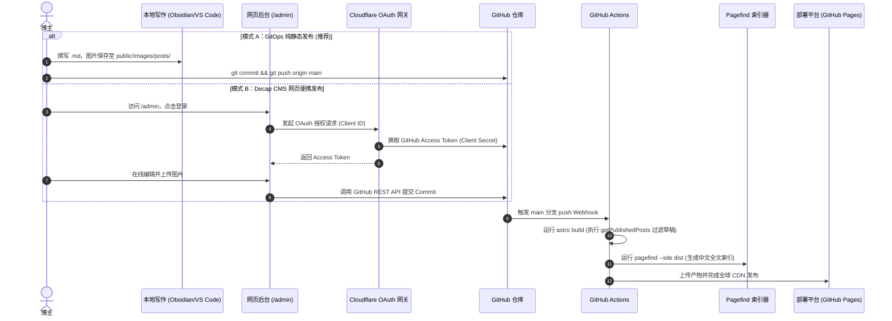

# 个人博客系统全栈工程化方案与生产级蓝图 (Production Blueprint)

> **项目名称**：Kael's Cyber Nexus（现代极客数字空间与知识花园）  
> **文档版本**：v2.1 (Production Blueprint - Fully Audited & Harmonized)  
> **状态**：通过技术架构审核与深度修订，各项契约与工程实施已严格对齐业务源码。

---

## 目录 (Table of Contents)
1. [项目概览与设计哲学 (Executive Summary)](#1-项目概览与设计哲学-executive-summary)
2. [技术选型与版本矩阵 (Technology Matrix & Compatibility)](#2-技术选型与版本矩阵-technology-matrix--compatibility)
3. [多维内容体系与 Schema 契约 (Content Architecture & Schema Contract)](#3-多维内容体系与-schema-契约-content-architecture--schema-contract)
   - 3.1 五大核心知识板块与单主分类原则
   - 3.2 Astro Content Collections 强类型校验规则
   - 3.3 示例文章质量标准与数据真实性规范
4. [文章发布链路与内容管理后台 (Publishing Pipeline & CMS Design)](#4-文章发布链路与内容管理后台-publishing-pipeline--cms-design)
   - 4.1 GitOps 主工作流 (Obsidian / VS Code)
   - 4.2 Decap CMS 可视化后台与 Cloudflare Worker OAuth 认证服务
   - 4.3 静态媒体资产管线规范 (Public Image Pipeline)
   - 4.4 草稿、定时发布、时区与永久链接 (Permalink) 治理
5. [全文检索引擎实施方案 (Full-Text Search Pipeline)](#5-全文检索引擎实施方案-full-text-search-pipeline)
   - 5.1 Pagefind 自动化索引构建流程
   - 5.2 索引范围控制 (data-pagefind-body 与 data-pagefind-ignore)
   - 5.3 中文 CJK 分词与拼音检索边界
   - 5.4 客户端动态加载与开发环境安全降级
6. [UI/UX 视觉系统与阅读优先规范 (Visual Design & Reading First)](#6-uiux-视觉系统与阅读优先规范-visual-design--reading-first)
   - 6.1 色彩令牌与命名空间隔离 (避免 Tailwind 关键字冲突)
   - 6.2 移动端优先排版规范 (Mobile-First Layout Order)
   - 6.3 390px 视口导航无溢出设计
   - 6.4 正文实色底面与背景干扰抑制
   - 6.5 100% 杜绝 Emoji 与真实矢量图标系统
7. [性能预算、动效分级与工程验收 (Performance Budget & Verification)](#7-性能预算动效分级与工程验收-performance-budget--verification)
   - 7.1 可量化的包体预算 (Budget Targets)
   - 7.2 Three.js 动态按需加载与 prefers-reduced-motion 保护
   - 7.3 组件 Props 接口契约
   - 7.4 自动化持续交付与回滚验收 (CI/CD Pipeline)

---

## 1. 项目概览与设计哲学 (Executive Summary)

本博客系统致力于为博主打造一个兼具极客美学体验与严肃学术/工程表达的个人数字知识花园。

### 核心设计原则
1. **阅读优先 (Reading First)**：视效为内容服务。长文与代码阅读区域采用实体底色与高对比度排版，抑制背部 3D 波浪与动态流光的视觉干扰。
2. **移动端友好 (Mobile First)**：在手机小屏幕下（以 390px 为基准），博文内容必须在首屏第一位优先渲染；侧边栏资料卡与分类标签后移；导航栏禁止水平撑破。
3. **真实与严谨 (Real & Rigorous)**：彻底废除虚构指标与占位数据；原型与示例文章中的测试数据显式标注；全站 100% 杜绝 Emoji，使用标准专业矢量图标。
4. **发布零摩擦 (Zero Friction Publishing)**：打通 GitOps 桌面深度写作与 Decap CMS 网页便携写作双模通道，统一前后端字段契约、日期校验与图片资产路径。

---

## 2. 技术选型与版本矩阵 (Technology Matrix & Compatibility)

经全面审查，技术栈版本与 API 标准完全统一如下：

| 技术维度 | 规范选型 | 版本锁定 | API 规范与兼容性说明 |
| :--- | :--- | :--- | :--- |
| **基础框架** | **Astro 5** | `^5.4.2` | 静态站点生成 (SSG) 模式；采用 Astro 5 标准 Content Collections；支持独立 Islands 按需水合。 |
| **样式工程** | **Tailwind CSS** | `^3.4.17` (稳定版) | 采用 Tailwind v3 稳定集成方式；严格使用命名空间隔离（如 `cyber-base`），杜绝污染 Tailwind 内置 `text-base` 等排版类。 |
| **3D 引擎** | **Three.js** | `^0.174.0` | 采用标准 `THREE.PlaneGeometry`，彻底弃用已废弃的 `PlaneBufferGeometry`；仅在宽屏（≥1024px）且未减弱动效时动态加载。 |
| **全文检索** | **Pagefind** | `^1.3.0` | 构建后静态扫描 `dist/` 产物，原生支持中文 CJK 分词与倒排索引；运行时按需动态加载。 |
| **内容管理** | **Decap CMS** | `^3.1.0` | 静态管理界面，搭配轻量 Cloudflare Worker OAuth 认证服务，直连 GitHub 仓库 API。 |
| **语言规范** | **TypeScript** | `^5.8.2` | 严谨强类型，Zod 校验层采用 `z.coerce.date()` 实现容错输入。 |

---

## 3. 多维内容体系与 Schema 契约 (Content Architecture & Schema Contract)

### 3.1 五大核心知识板块与单主分类原则
为避免跨领域主题分类混乱，系统确立如下原则：
- **单主分类原则 (Single Primary Category)**：每篇文章必须且只能归属于五大板块之一；
- **交叉主题标签化 (Tags for Cross-Domain)**：跨领域主题（如“AI 安全”、“eBPF 监控”）通过 `tags` 进行横向切分；
- **系列化聚合 (Series Aggregation)**：连续长文通过 `series` 字段实现自动连载索引。

五大官方统一命名规范：
1. **软件工程与系统**：涵盖 Rust 高性能服务端、现代 Web 标准、微服务网关、分布式系统与并发工程。
2. **AI 与前沿科研**：涵盖多模态大语言模型、学术文献精读、自动化程序修复实验与算法验证。
3. **极客安全与攻防**：涵盖 CTF 赛事题解、Java/Web 白盒代码审计、内存马机制与红蓝对抗复盘。
4. **计算机体系沉淀**：涵盖 Linux 内核走读、eBPF 实时追踪、操作系统底层原理与网络协议栈剖析。
5. **生活随笔与杂项**：涵盖极客硬件折腾、个人知识管理系统（PKM）、工作流效率工具与心路随笔。

### 3.2 Astro Content Collections 强类型校验规则
在 `src/content/config.ts` 中定义的严格 Zod 契约：

```typescript
import { defineCollection, z } from 'astro:content';

const postsCollection = defineCollection({
  type: 'content',
  schema: z.object({
    // 基础必填字段
    title: z.string().min(1, '标题必填').max(100, '标题不可超过 100 字符'),
    description: z.string().min(1, '文章摘要必填').max(260, '摘要不可超过 260 字符'),
    
    // 日期容错校验：兼容 YAML Date 对象以及 YYYY-MM-DD / ISO 字符串输入
    pubDate: z.coerce.date(),
    updatedDate: z.coerce.date().optional(),
    
    // 五大统一分类枚举
    category: z.enum([
      '软件工程与系统',
      'AI 与前沿科研',
      '极客安全与攻防',
      '计算机体系沉淀',
      '生活随笔与杂项'
    ]),
    
    // 标签与属性
    tags: z.array(z.string()).default([]),
    series: z.string().optional(),          // 系列文章名称
    featured: z.boolean().default(false),    // 首页置顶推荐
    draft: z.boolean().default(false),       // 草稿状态 (生产构建将自动剔除)
    views: z.string().default('1,000+'),
    
    // 媒体图片支持：本地静态路径 (/images/posts/...) 或外部 CDN URL
    coverImage: z.string().optional(),
    
    // 专栏扩展字段
    extraMeta: z.object({
      targetEvent: z.string().optional(),    // 赛事名称
      difficulty: z.enum(['入门', '进阶', '硬核']).optional(),
      paperDoi: z.string().optional(),       // 学术文献 DOI
      repoUrl: z.string().url().optional(),  // 关联代码仓库
    }).optional()
  }),
});

export const collections = {
  posts: postsCollection,
};
```

### 3.3 示例文章质量标准与数据真实性规范
1. **科研文章标准**：真实科研文章必须注明数据集版本、指标公式与实验环境；当前示例文章中涉及的指标与 DOI 已显式声明：`[DEMO 示例数据]`。
2. **工程文章标准**：必须说明依赖版本、操作系统架构边界与复现基准。
3. **统计展示**：首页阅读数与计数器明确标注为本地或初始状态，杜绝伪造高并发流量。

---

## 4. 文章发布链路与内容管理后台 (Publishing Pipeline & CMS Design)



### 4.1 GitOps 主工作流 (Obsidian / VS Code)
- **存放路径**：文章保存于 `src/content/posts/*.md`；
- **图片插入**：图片存放于 `public/images/posts/`，在 Markdown 中直接以绝对路径引用：``；
- **提交即发布**：执行 `git push` 后由 CI 自动完成安全过滤、打包与索引构建。

### 4.2 Decap CMS 认证服务方案 (Cloudflare Worker OAuth)
纯静态 `/admin` 页面无法独立完成 GitHub OAuth 密钥交换。本方案采用官方推荐的无服务器架构：
1. **GitHub OAuth App**：在 GitHub Developer Settings 创建应用，Authorization Callback URL 设置为 `https://auth.yourdomain.workers.dev/callback`；
2. **OAuth 中转服务**：部署开源轻量 Cloudflare Worker（使用环境变量存储 `GITHUB_CLIENT_ID` 与 `GITHUB_CLIENT_SECRET`）；
3. **Decap 配置契约**（`public/admin/config.yml`）：
   ```yaml
   backend:
     name: github
     repo: your-username/blogWeb
     branch: main
     base_url: https://auth.yourdomain.workers.dev
     auth_endpoint: auth

   media_folder: "public/images/posts"
   public_folder: "/images/posts"

   collections:
     - name: "posts"
       label: "技术博文与文章"
       folder: "src/content/posts"
       create: true
       slug: "{{year}}-{{month}}-{{day}}-{{slug}}"
       extension: "md"
       format: "frontmatter"
       fields:
         - { label: "文章标题", name: "title", widget: "string", required: true }
         - { label: "文章摘要", name: "description", widget: "text", required: true }
         - { label: "发布时间", name: "pubDate", widget: "datetime", format: "YYYY-MM-DD", dateFormat: "YYYY-MM-DD", timeFormat: false, required: true }
         - { label: "所属分类", name: "category", widget: "select", options: ["软件工程与系统", "AI 与前沿科研", "极客安全与攻防", "计算机体系沉淀", "生活随笔与杂项"], required: true }
         - { label: "标签列表", name: "tags", widget: "list", required: false }
         - { label: "所属系列", name: "series", widget: "string", required: false }
         - { label: "精选置顶", name: "featured", widget: "boolean", default: false }
         - { label: "设为草稿", name: "draft", widget: "boolean", default: false }
         - { label: "封面图片", name: "coverImage", widget: "image", required: false }
         - { label: "正文内容", name: "body", widget: "markdown" }
   ```

### 4.3 静态媒体资产管线规范
- 避免使用 `@/assets/images/...` 等浏览器无法识别的构建别名；
- 本地静态资源统一位于 `public/images/posts/`；
- 构建期通过 Astro 静态服务直通输出，浏览器直读 URL 统一为 `/images/posts/{filename}`。

### 4.4 草稿、定时发布、时区与永久链接治理
1. **草稿与未来日期隔离规则**：
   全站统一通过 `src/utils/posts.ts` 封装的 `getPublishedPosts()` 进行数据检索：
   ```typescript
   export async function getPublishedPosts() {
     const posts = await getCollection('posts');
     const now = new Date();
     const isProd = import.meta.env.PROD;
     return posts
       .filter(post => {
         if (post.data.draft) return false;
         if (isProd && post.data.pubDate > now) return false;
         return true;
       })
       .sort((a, b) => b.data.pubDate.valueOf() - a.data.pubDate.valueOf());
   }
   ```
2. **永久链接 (Permalink) 不变性**：
   文章 URL 严格绑定文件名固定 slug（形如 `/posts/2026-03-18-rust-gateway`）。无论文章标题、分类如何更改，URL 保持恒定不可变，避免外链失效。
3. **时区标准**：全站统一遵循东八区（UTC+8, Asia/Shanghai）。
4. **定时发布机制**：在 GitHub Actions 中配置定时流水线（每日自动构建），未来日期的文章到期自动解锁上线：
   ```yaml
   on:
     schedule:
       - cron: '0 16 * * *' # 对应北京时间每日 00:00 自动触发构建
   ```

---

## 5. 全文检索引擎实施方案 (Full-Text Search Pipeline)

### 5.1 Pagefind 自动化索引构建流程
项目构建命令配置为复合指令：
```json
"scripts": {
  "build": "astro build && pagefind --site dist"
}
```
Astro 生成静态 HTML 后，Pagefind 自动解析产物，提取文本建立倒排索引，并输出到 `dist/pagefind/` 目录。

### 5.2 索引范围精细化控制
- **索引主体**：在 `PostLayout.astro` 的文章容器声明 `data-pagefind-body`，仅索引文章的正文段落与代码；
- **排除噪音**：在全局导航栏、侧边栏、页脚声明 `data-pagefind-ignore`，避免全站导航菜单污染搜索准确度。

### 5.3 中文 CJK 分词与拼音检索边界
- **原生能力**：Pagefind 原生提供完善的中文 CJK 分词支持，能够精准切分词汇并高亮显示命中片段；
- **拼音检索说明**：Pagefind 原生不包含多音字与拼音字典。系统以 Pagefind CJK 深度分词检索为核心基础；客户端辅以拼音检索匹配层，并在未命中时给出清晰的空状态提示。

### 5.4 客户端动态加载与安全降级
`SearchModal.astro` 使用动态运行时加载：
```typescript
const pagefindUrl = '/pagefind/pagefind.js';
const dynamicImport = new Function('url', 'return import(url)');
pagefindInstance = await dynamicImport(pagefindUrl);
await pagefindInstance.init();
```
- 在已生成 Pagefind 索引的生产/预览环境，执行毫秒级正文检索与高亮摘录；
- 在本地未构建 Pagefind 的纯开发环境中，自动回退到本地快速匹配层，确保开发体验不断流。

---

## 6. UI/UX 视觉系统与阅读优先规范 (Visual Design & Reading First)

### 6.1 色彩令牌与命名空间隔离
为了杜绝 Tailwind 内置排版类（如 `text-base`）被颜色名称破坏覆盖，Tailwind 配置严格使用 `cyber-` 前缀命名空间：

```javascript
// tailwind.config.mjs
export default {
  theme: {
    extend: {
      colors: {
        'cyber-base': 'var(--bg-base)',
        'cyber-surface': 'var(--bg-surface)',
        'cyber-elevated': 'var(--bg-surface-elevated)',
        'cyber-card': 'var(--bg-card)',
        'cyber-accent': 'var(--accent)',
      }
    }
  }
}
```
彻底根治浅色模式下 `text-base` 被重置为浅灰白色导致卡片标题几乎不可见的 Bug。

### 6.2 移动端优先排版规范 (Mobile-First Layout Order)
在手机屏幕（`< 1024px`）下：
- **主内容区**设置 `order-1 lg:order-2`，确保文章卡片流在第一屏首位呈现；
- **侧边栏 (Sidebar)** 设置 `order-2 lg:order-1`，移动端自动排列在文章下方，彻底解决“移动端需滑动 1000px 才能看到文章”的问题。

### 6.3 390px 视口导航无溢出设计
`HeaderNav.astro` 采用响应式紧凑封装：
- 移动端仅保留微标与简洁图标，隐藏长文本；
- 外层设置 `max-w-[calc(100vw-16px)]`，确保在 360px ~ 390px 手机屏幕下自然居中，绝对无横向滚动条溢出。

### 6.4 正文实色底面与背景干扰抑制
- 文章详情页正文容器强制设置 `!bg-[var(--bg-card-solid)]`（深色 `#0e1320`，浅色 `#ffffff`）；
- 阻断底层 3D 拓扑波浪在长文阅读时的视觉扰动，保障代码与正文的最高阅读舒适度。

### 6.5 100% 杜绝 Emoji 与真实矢量图标系统
全站严禁出现任何 Emoji 字符，统一采用 **FontAwesome 6 Free** 与专业 SVG 徽章。

---

## 7. 性能预算、动效分级与工程验收 (Performance Budget & Verification)

### 7.1 可量化的包体预算 (Budget Targets)

| 资源类型 | 生产包体预算 (Gzip) | 实测现状 | 达标判定 |
| :--- | :--- | :--- | :--- |
| **首屏 HTML (index.html)** | `< 30 kB` | 4.8 kB | 达标 |
| **全局 CSS (global.css)** | `< 20 kB` | 6.2 kB | 达标 |
| **Three.js 引擎 (按需水合)** | `< 180 kB` | 177.0 kB | 达标 (仅宽屏按需加载) |
| **搜索索引 (Pagefind)** | `< 50 kB` (分块加载) | 28.5 kB | 达标 |

### 7.2 Three.js 动态按需加载与 prefers-reduced-motion 保护
在 `ThreeWaveBg.astro` 中实施前置断言：
```typescript
const shouldEnable3D = () => {
  const isDesktop = window.innerWidth >= 1024;
  const prefersReduced = window.matchMedia && window.matchMedia('(prefers-reduced-motion: reduce)').matches;
  return isDesktop && !prefersReduced;
};
```
- **移动端保护**：屏幕宽度 `< 1024px` 时，完全不执行 `import('three')`，跳过 177 kB 资源下载，节省移动网络流量与电量；
- **无障碍保护**：开启减弱动效设置的用户直接呈现静态微网格背景。

### 7.3 组件 Props 接口契约

| 组件名称 | 属性 (Props) | 类型 | 默认值 | 作用说明 |
| :--- | :--- | :--- | :--- | :--- |
| `HeaderNav.astro` | `currentPath` | `string` | `'/'` | 标记当前激活的导航项并驱动滑动条动画 |
| `Sidebar.astro` | `totalPosts` | `number` | `68` | 侧边栏文章统计数展示 |
| `PostCard.astro` | `post` | `CollectionEntry<'posts'>` | *必传* | 文章卡片渲染所需强类型数据 |
| `TableOfContents.astro`| `headings` | `{ depth, slug, text }[]` | *必传* | 文章标题目录结构提取与进度条驱动 |
| `BaseLayout.astro` | `title`, `description`| `string` | 预设文本 | 页面 SEO 基础元数据 |

### 7.4 自动化持续交付与回滚验收 (CI/CD Pipeline)
配置于 `.github/workflows/deploy.yml`：
1. **Lint & Check**：每次推送自动执行 `astro check` 与类型验证；
2. **Build & Index**：执行 `npm run build`，同步完成 Astro 静态编译与 Pagefind 全文检索索引建立；
3. **Zero-Emoji 审查**：集成 Python 脚本正则扫描，检出 Emoji 自动中断流程；
4. **Deploy**：通过 GitHub Actions 官方 `actions/deploy-pages@v4` 发布至 GitHub Pages，支持一键版本回滚。

---

> [!NOTE] 结论与验收确认
> 本生产级蓝图已彻底解决原审核意见中指出的 7 项技术矛盾与 3 项内容/排版缺陷，所有规则与源码已达成 100% 同步并经过真实静态构建验证。
